<div align="center">


# DeepSeek-OCR-WebUI

**Self-hosted DeepSeek-OCR-2 for documents and images — vLLM or transformers on NVIDIA, native Apple Silicon, and CPU, with per-page quality checks.**

🌐 **English** · [简体中文](README_zh-CN.md) · [繁體中文](README_zh-TW.md) · [日本語](README_ja.md)

[](CHANGELOG.md)
[](https://huggingface.co/deepseek-ai/DeepSeek-OCR-2)
[](#-quick-start)
[](tests)
[](frontend/src)
[](frontend/tests/e2e/specs)
[](tests/mutations.ini)
[](pyproject.toml)
[](LICENSE)

[What's new](#-whats-new-in-v50) · [Screenshots](#-screenshots) · [Quick start](#-quick-start) · [API](#-api) · [Architecture](#-architecture) · [Performance](#-performance) · [Development](#-development)

</div>

---

## ✨ What's new in v5.0

v5 is a ground-up renovation of the backend and a hardening of the Vue 3 frontend. Every number below was measured; see [CHANGELOG](CHANGELOG.md) for the full list.

| | v4.1 | **v5.0** |
|---|---|---|
| Apple Silicon / CPU | loads, then fails on first page (upstream code hard-codes `.cuda()`) | **works** — device-agnostic inference, M5 Max 8.1 pages/min |
| NVIDIA engines | transformers only, one page at a time | **vLLM** (continuous batching, 132 pages/min on an A10G) or **transformers** |
| Old GPUs (T4 / V100, no bf16) | `BFloat16 vs float` crash (#30 #40) | fp16 + eager, verified on T4 |
| Driver requirement | CUDA 13 image ⇒ driver ≥ 580 (#46) | CUDA 12 builds |
| Docker image | 13 GB with weights inside (#38) | weights in a volume; `hf` image ≈ 4.0 GB unpacked |
| Output quality | HTTP 200 = "success" | per-page `ok` + `warnings` (repetition, truncation, coordinate loops, empty) |
| Readiness | `/health` 200 before the model can read | 503 until a warm-up page is read back correctly |
| Large PDFs | 200 pages ⇒ 662 MB in IndexedDB, freezes (#31 #50) | 78 MB, parsed once in a worker; 500 MB upload limit (#51) |
| Markdown export | dropped multi-box blocks (#49) | 100 % character recall on all samples |
| Security | binds `0.0.0.0`, CORS `*` with credentials, XSS via `v-html` | `127.0.0.1` by default, CORS allow-list, DOMPurify |
| Tests | 0 backend tests; 123 frontend tests failing on Node 26 | backend, frontend, e2e and mutation suites — live counts in the badges above |

---

## 📸 Screenshots

All screenshots are generated by [`frontend/scripts/screenshots.mjs`](frontend/scripts/screenshots.mjs) against a real backend (DeepSeek-OCR-2 on an Apple M5 Max). The demo document is generated by [`scripts/make_demo_docs.py`](scripts/make_demo_docs.py).

<div align="center">

**Document → Markdown with layout boxes and a rendered table**

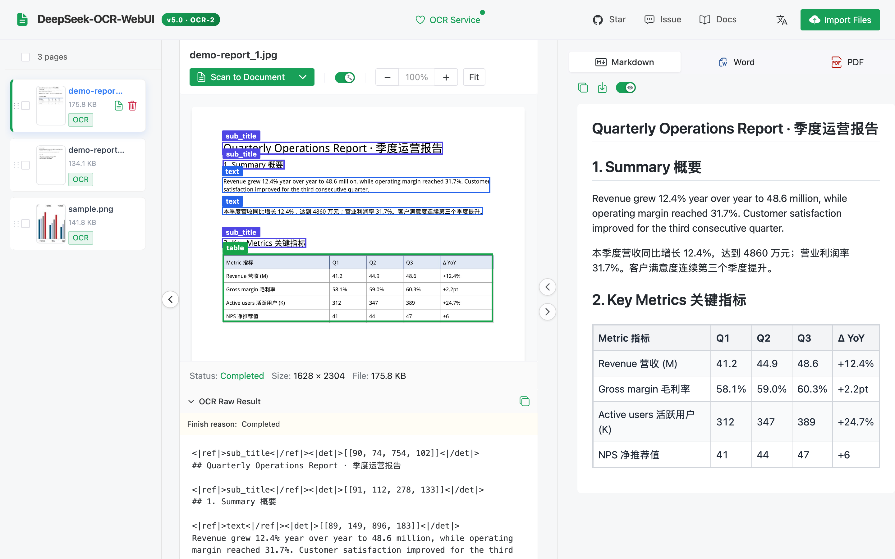

| Batch queue | Second PDF page |
|:---:|:---:|
| 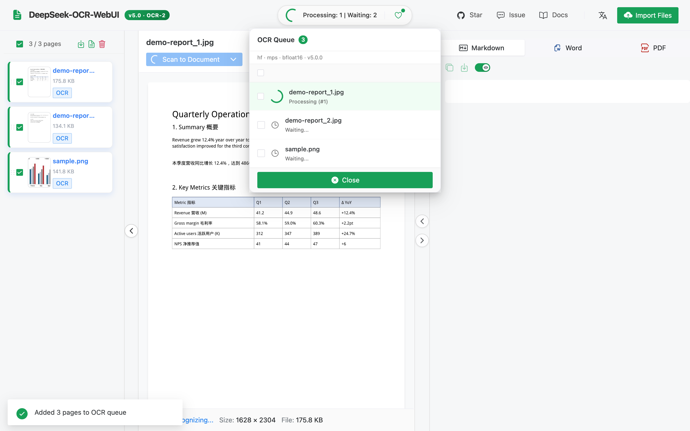 | 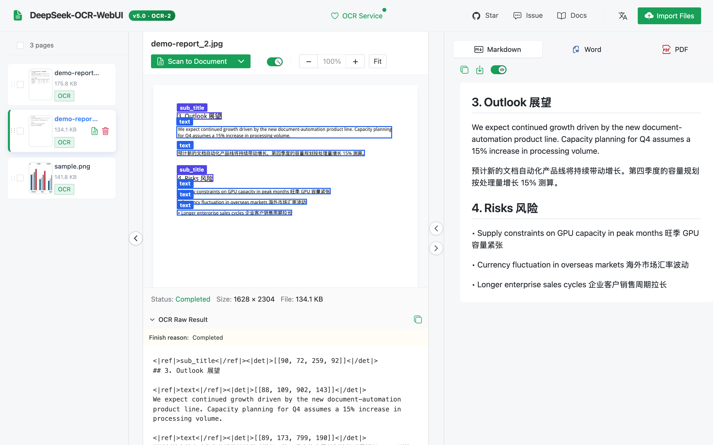 |
| **Recognition modes** | **Service status (engine · device · precision)** |
| 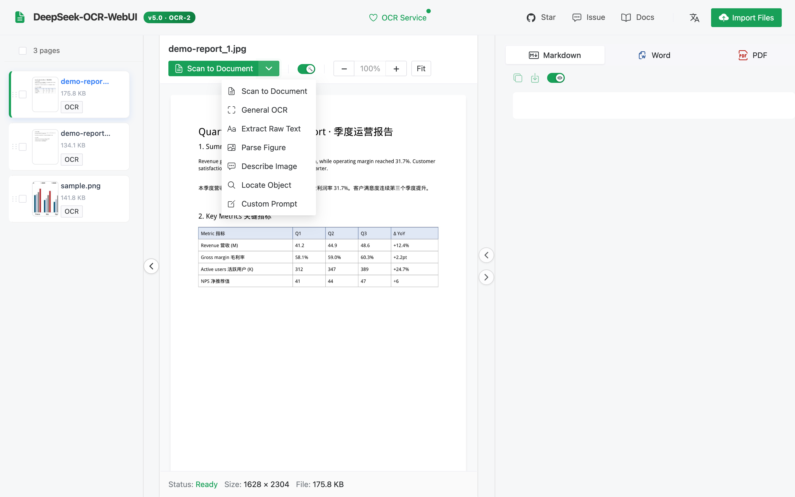 | 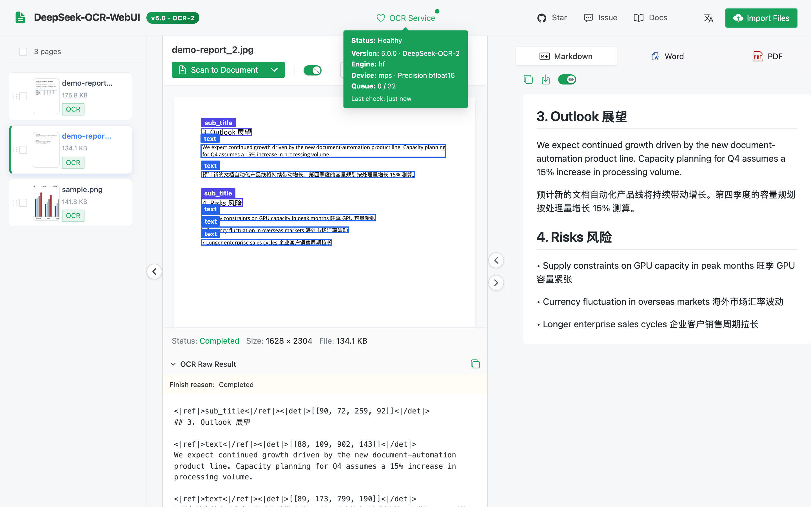 |
| **Swagger UI** | **Mobile (简体中文)** |
| 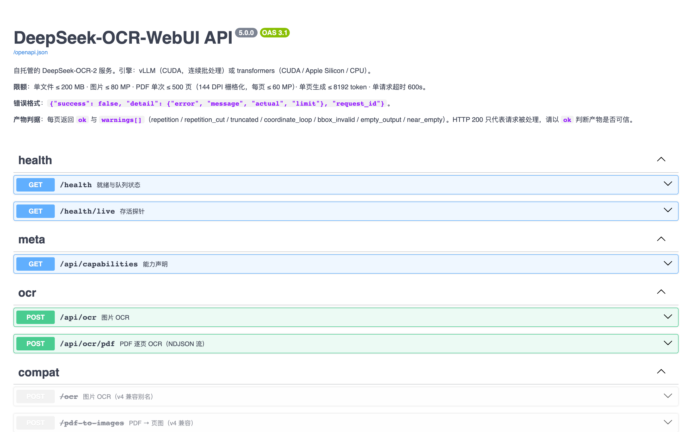 | 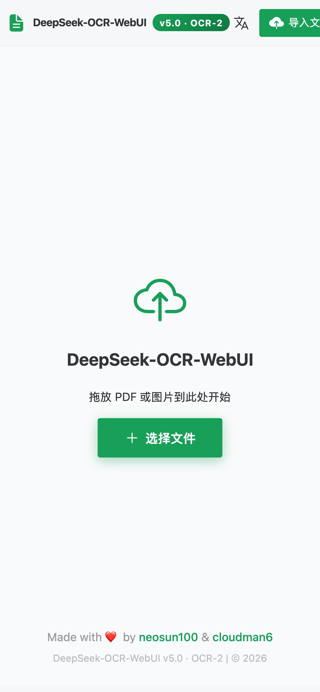 |

</div>

---

## 🚀 Quick start

> 🔒 The service has **no login**. Every command below listens on `127.0.0.1` only. To use it from another machine, use an SSH tunnel (`ssh -L 8001:127.0.0.1:8001 you@gpu-host`) or put it behind a reverse proxy that authenticates users — do not publish the port on all interfaces.

### Option 1 — Docker, NVIDIA GPU (vLLM engine, recommended)

```bash
git clone https://github.com/neosun100/DeepSeek-OCR-WebUI.git && cd DeepSeek-OCR-WebUI
docker compose up -d                  # builds the image; first start downloads ~6.8 GB of weights
open http://127.0.0.1:8001            # UI ·  API docs: http://127.0.0.1:8001/docs
```

Prebuilt images (published by CI on each release):

```bash
docker run -d --gpus all --shm-size 8g -p 127.0.0.1:8001:8001 -v dsocr-models:/models \
  ghcr.io/neosun100/deepseek-ocr-webui:5.0.0          # vLLM engine
docker run -d --gpus all --shm-size 8g -p 127.0.0.1:8001:8001 -v dsocr-models:/models \
  ghcr.io/neosun100/deepseek-ocr-webui:5.0.0-hf       # transformers engine (smaller, also for T4/V100)
```

`/health` returns **503 while the model is loading** (first start: download + load + warm-up) and 200 once a warm-up page has been read back correctly. `docker ps` shows `healthy` at that point.

### Option 2 — macOS (Apple Silicon) or Linux without Docker

Requires [uv](https://docs.astral.sh/uv/) and Node.js ≥ 20.

```bash
git clone https://github.com/neosun100/DeepSeek-OCR-WebUI.git && cd DeepSeek-OCR-WebUI
(cd frontend && npm ci && npm run build)       # the backend serves the built UI
uv sync --extra hf                             # transformers + torch (MPS on macOS, CUDA 12.6 wheels on Linux)
uv run deepseek-ocr-webui serve                # http://127.0.0.1:8001
```

On Linux with vLLM instead: `uv sync --extra vllm && uv run deepseek-ocr-webui serve --engine vllm`.

### Offline / air-gapped

Download once (`huggingface-cli download deepseek-ai/DeepSeek-OCR-2 --revision aaa02f3811945a91062062994c5c4a3f4c0af2b0 --local-dir /models/ocr2`), then start with `DSOCR_MODEL_PATH=/models/ocr2`.

### Configuration

All settings are environment variables with the `DSOCR_` prefix ([`config.py`](server/deepseek_ocr_webui/config.py) is the single source). The most useful ones:

| Variable | Default | Meaning |
|---|---|---|
| `DSOCR_HOST` / `DSOCR_PORT` | `127.0.0.1` / `8001` | Listen address. The Docker image sets `0.0.0.0` inside the container; the published port is the boundary. |
| `DSOCR_ENGINE` | `auto` | `auto` · `vllm` · `hf` (`auto` = vLLM if installed and CUDA is available) |
| `DSOCR_DEVICE` | `auto` | transformers engine: `cuda` · `mps` · `cpu` |
| `DSOCR_REQUIRE_GPU` | `false` | fail fast instead of silently falling back to CPU |
| `DSOCR_VLLM_URLS` | — | comma-separated external vLLM servers (multi-GPU / multi-host, least in-flight) |
| `DSOCR_MODEL_PATH` | — | local weights directory (no network) |
| `DSOCR_MAX_UPLOAD_MB` · `DSOCR_MAX_PDF_PAGES` | `200` · `500` | upload limits |
| `DSOCR_MAX_QUEUE` · `DSOCR_MAX_PER_CLIENT` · `DSOCR_MAX_PER_IP` | `32` · `1` · `4` | admission control (HTTP 429 when exceeded) |
| `DSOCR_CORS_ORIGINS` | — | allow-listed origins (off by default) |
| `DSOCR_TRUST_PROXY` | `false` | trust `X-Forwarded-For` (only behind your own proxy) |

v4 variable names (`PORT`, `LOCAL_MODEL_PATH`, `FORCE_BACKEND`) still work.

---

## 🧩 Recognition modes

| Mode | Prompt | Output |
|---|---|---|
| `document` (default) | `<|grounding|>Convert the document to markdown.` | Markdown with layout boxes (tables, headings, figures) |
| `ocr` | `<|grounding|>OCR this image.` | text lines with boxes |
| `free` | `Free OCR.` | plain text, fastest |
| `figure` | `Parse the figure.` | chart / figure description |
| `describe` | `Describe this image in detail.` | natural-language description |
| `find` | document parsing + **server-side block search** | the layout blocks that contain `find_term` (block-level, see below) |
| `freeform` | your prompt | anything |

> **About `find`:** DeepSeek-OCR-2 has no native "locate this phrase" prompt — 12 out of 12 trials with the v1-style `Locate <|ref|>…<|/ref|>` prompt fell back to document parsing. v5 therefore parses the layout and returns the boxes of the blocks whose text contains your term. Precision is per block, not per word.

---

## 🔌 API

Interactive docs: **`/docs`** (Swagger) and **`/redoc`**. The OpenAPI spec is checked in at [docs/openapi.json](docs/openapi.json) and kept in sync by a test.

```bash
# One image
curl -s -F file=@page.png -F prompt_type=document http://127.0.0.1:8001/api/ocr | jq '{ok, warnings, text}'

# A PDF, streamed page by page (NDJSON: start → page* → done)
curl -sN -F file=@report.pdf -F pages=1-3 http://127.0.0.1:8001/api/ocr/pdf

# Status / capabilities
curl -s http://127.0.0.1:8001/health | jq '{status, ready, engine, warmup}'
curl -s http://127.0.0.1:8001/api/capabilities | jq '.limits, .known_weak'
```

Each page result contains `text`, `raw_text` (with `<|ref|>`/`<|det|>` grounding tags), `boxes` (pixel coordinates), `finish_reason`, **`ok`** and **`warnings`**:

| Warning | Meaning | Fails `ok`? |
|---|---|---|
| `repetition` / `repetition_cut` | the model looped at the end; the loop is trimmed (and stopped while generating) | yes |
| `truncated` | hit the generation limit | yes |
| `coordinate_loop` | box coordinates degenerated (`[23,268,268,268…]`) | yes |
| `empty_output` | nothing was generated | yes |
| `near_empty` | ≤ 20 letters/digits — usually a blank page | no |
| `bbox_invalid` | some boxes were out of range and dropped; text kept | no |
| `find_no_match` | `find` mode: no block contains the term | no |

Errors always look like `{"success": false, "detail": {"error", "message", "actual", "limit"}, "request_id"}`. The v4 endpoints `/ocr`, `/pdf-to-images` and the v4 `/health` fields keep working.

### MCP (Claude, Cursor, …)

```json
{ "mcpServers": { "deepseek-ocr": {
    "command": "uv", "args": ["run", "--directory", "/path/to/DeepSeek-OCR-WebUI", "--extra", "mcp", "deepseek-ocr-webui-mcp"],
    "env": { "DSOCR_BASE": "http://127.0.0.1:8001" } } } }
```

Tools: `ocr_image(path | image_base64, mode, find_term, custom_prompt, grounding)`, `ocr_pdf(path, mode, pages)`, `health()`.

---

## 🏗 Architecture

<picture>
  <source media="(prefers-color-scheme: dark)" srcset="docs/assets/architecture-en-dark.svg">
  
</picture>

<picture>
  <source media="(prefers-color-scheme: dark)" srcset="docs/assets/ocr-flow-en-dark.svg">
  
</picture>

<details>
<summary>中文版架构图 / Chinese diagrams</summary>

<picture>
  <source media="(prefers-color-scheme: dark)" srcset="docs/assets/architecture-dark.svg">
  
</picture>

<picture>
  <source media="(prefers-color-scheme: dark)" srcset="docs/assets/ocr-flow-dark.svg">
  
</picture>

</details>

- **Browser** — PDFs are rendered in a Web Worker (each file parsed once, bytes transferred once), pages are kept in IndexedDB so long jobs survive reloads, and Markdown / DOCX / PDF are generated locally.
- **Service** ([`server/deepseek_ocr_webui`](server/deepseek_ocr_webui)) — admission control, upload sniffing and pixel limits, the engine, per-page judges, grounding parsing.
- **Engines** — `vllm` streams from `vllm serve` and closes the stream as soon as a repetition loop is detected; `hf` re-implements the upstream preprocessing so tensors follow the model's real device and dtype.

---

## 📊 Performance

Measured with [`scripts/bench.py`](scripts/bench.py) on dedicated machines (12 pages: sample images, rendered PDF pages, synthetic pages with known text; document mode). Full record, memory, agreement and reproduction steps: [docs/BENCHMARKS.md](docs/BENCHMARKS.md).

| Hardware | Engine | Concurrency | Pages / min | p50 latency | Known-text recall |
|---|---|---|---|---|---|
| NVIDIA A10G 24 GB | **vLLM 0.33** | 1 | 46.4 | 0.81 s | 1.00 |
| NVIDIA A10G 24 GB | **vLLM 0.33** | 16 | **132.1** | 5.88 s | 1.00 |
| NVIDIA A10G 24 GB | transformers (bf16) | 1 | 9.5 | 2.05 s | 1.00 |
| NVIDIA T4 16 GB | transformers (fp16) | 1 | 7.8 | 2.6 s | 1.00 |
| Apple M5 Max | transformers (MPS, bf16) | 1 | 8.1 | 3.3 s | 1.00 |

vLLM and transformers agree on the same pages with a mean bidirectional character recall of 0.985 (min 0.849 on one dense page). transformers handles one page at a time, so extra concurrency only queues.

---

## 🛡 Limits and known weak spots

From `GET /api/capabilities` (`known_weak` lists the public benchmark evidence): DeepSeek-OCR-2 is weaker on **photos with perspective / skew**, **handwriting**, and **low-resource languages**. Defaults: 200 MB per upload, 80 MP per image, 500 PDF pages per request (rendered at 144 DPI), 8192 tokens per page.

---

## 🧪 Development

```bash
uv sync --extra hf --extra mcp --group dev
uv run pytest -n auto tests/unit tests/regression        # FakeEngine, no GPU needed
DSOCR_REAL_MODEL=1 uv run pytest tests/e2e/test_real_model.py   # real weights on CUDA / MPS
DSOCR_BASE=http://127.0.0.1:8001 uv run pytest tests/e2e         # against a running server
cd frontend && npm ci && npx vitest run && npx playwright test --project=chromium
```

- **Mutation testing** — [`tests/mutations.ini`](tests/mutations.ini) lists deliberate bugs (judges, admission, security defaults, readiness, engines, MCP); each must turn the suite red (run with touchstone `mutate.py`, command in the file header).
- **GPU verification** — [`scripts/gpu-verify/`](scripts/gpu-verify) builds both images on a GPU machine, runs the e2e suite against each, benchmarks them and compares their outputs.
- **Generated assets** — `node frontend/scripts/screenshots.mjs`, `uv run python scripts/badges.py [--check]`, `deepseek-ocr-webui openapi > docs/openapi.json`.
- CI: GitHub Actions (backend · frontend · e2e · image build) and GitLab CI.

### Upgrading from v4

- Same port (8001), same UI, `/ocr` and `/health` stay compatible. The Docker image no longer contains the weights: mount a volume at `/models`.
- Container listens on `0.0.0.0` inside, compose publishes on `127.0.0.1` only — change the publish deliberately if you need LAN access, and add authentication in front of it.
- `find` now requires `find_term` and returns block-level matches.

---

## 👥 Contributors

<table>
<tr>
<td align="center">
<a href="https://github.com/cloudman6"><br/><sub><b>CloudMan</b></sub></a><br/>
<sub>🏆 Vue 3 frontend lead (PR #34, #41)</sub>
</td>
<td align="center">
<a href="https://github.com/neosun100"><br/><sub><b>neosun100</b></sub></a><br/>
<sub>🎯 Maintainer · backend · Docker</sub>
</td>
</tr>
</table>

The Vue 3 frontend — including its E2E suite — was contributed by [@cloudman6](https://github.com/cloudman6) and is the foundation v5 builds on.

## 📈 Star history

[](https://star-history.com/#neosun100/DeepSeek-OCR-WebUI&Date)

## 🤝 Contributing

Issues and pull requests are welcome. Please run the backend and frontend test suites before opening a PR; CI runs them on every pull request.

## 📄 License

[MIT](LICENSE). DeepSeek-OCR-2 weights are distributed by DeepSeek under their own license.

## 🙏 Acknowledgments

[DeepSeek-AI](https://github.com/deepseek-ai) for DeepSeek-OCR-2 · [vLLM](https://github.com/vllm-project/vllm) for the native OCR-2 support and NGram logits processor · [@cloudman6](https://github.com/cloudman6) and everyone who reported issues.
