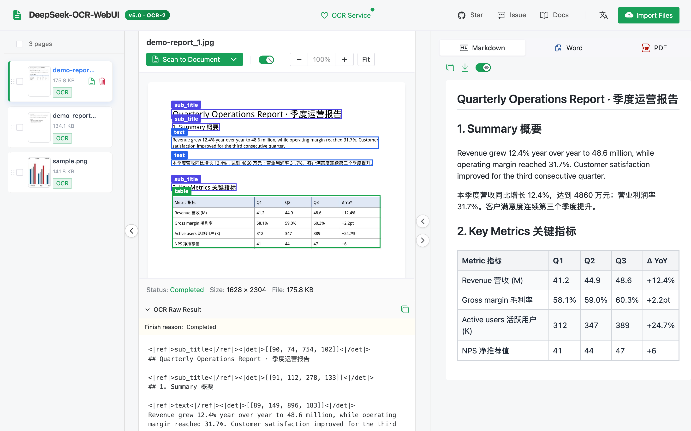
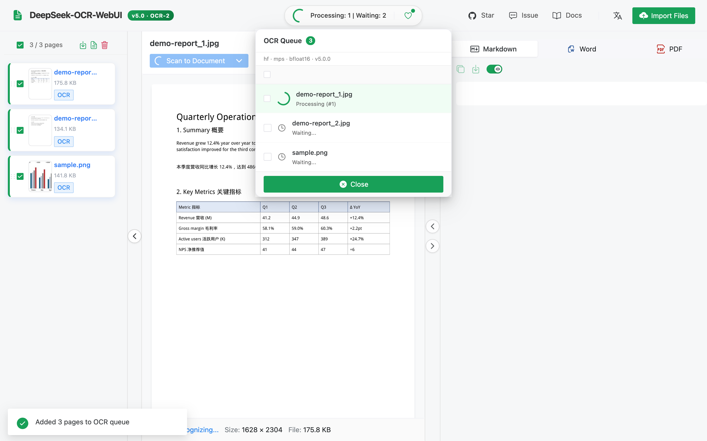
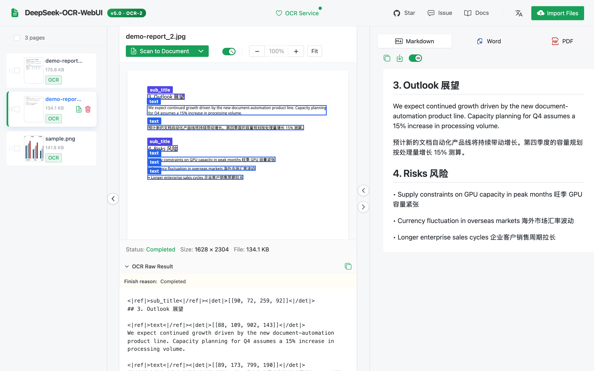
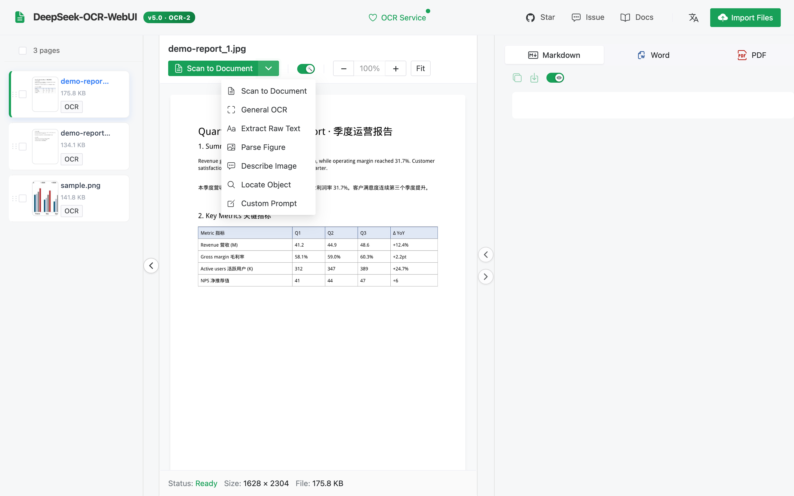
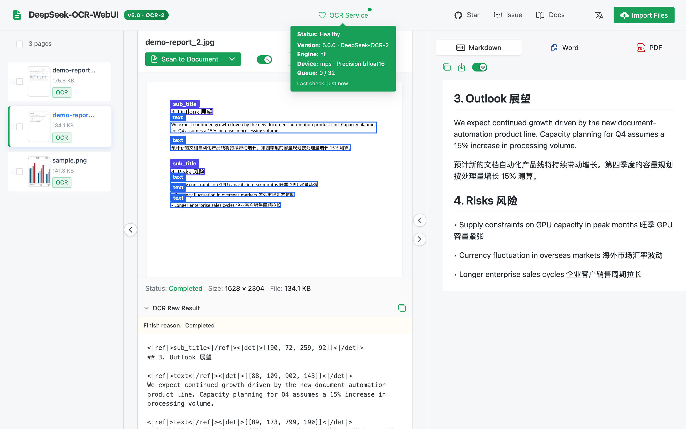
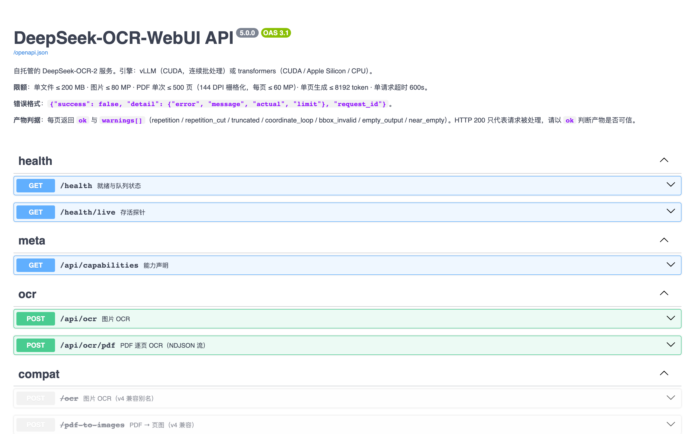
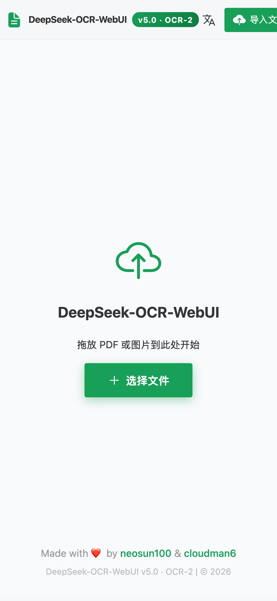

<div align="center">


# DeepSeek-OCR-WebUI

**文書と画像のためのセルフホスト型 DeepSeek-OCR-2 —— NVIDIA では vLLM または transformers、Apple Silicon と CPU にもネイティブ対応、ページごとの品質チェック付き。**

🌐 [English](README.md) · [简体中文](README_zh-CN.md) · [繁體中文](README_zh-TW.md) · **日本語**

[](CHANGELOG.md)
[](https://huggingface.co/deepseek-ai/DeepSeek-OCR-2)
[](#-クイックスタート)
[](tests)
[](frontend/src)
[](frontend/tests/e2e/specs)
[](tests/mutations.ini)
[](pyproject.toml)
[](LICENSE)

[新機能](#-v50-の新機能) · [スクリーンショット](#-スクリーンショット) · [クイックスタート](#-クイックスタート) · [API](#-api) · [アーキテクチャ](#-アーキテクチャ) · [パフォーマンス](#-パフォーマンス) · [開発](#-開発)

</div>

---

## ✨ v5.0 の新機能

v5 はバックエンドを一から作り直し、Vue 3 フロントエンドを堅牢化したリリースです。以下の数値はすべて実測値です。全項目は [CHANGELOG](CHANGELOG.md) を参照してください。

| | v4.1 | **v5.0** |
|---|---|---|
| Apple Silicon / CPU | 読み込めるが最初のページで失敗（上流コードが `.cuda()` をハードコード） | **動作する** —— デバイス非依存の推論、M5 Max で 8.1 ページ/分 |
| NVIDIA エンジン | transformers のみ、1 ページずつ | **vLLM**（continuous batching）または **transformers** |
| 古い GPU（T4 / V100、bf16 非対応） | `BFloat16 vs float` でクラッシュ（#30 #40） | fp16 + eager、T4 で検証済み |
| ドライバ要件 | CUDA 13 イメージ ⇒ ドライバ ≥ 580（#46） | CUDA 12 ビルド |
| Docker イメージ | 重みを含めて 13 GB（#38） | 重みは volume に配置。`hf` イメージは展開後 ≈ 4.0 GB |
| 出力品質 | HTTP 200 =「成功」 | ページごとの `ok` + `warnings`（繰り返し、切り捨て、座標ループ、空出力） |
| レディネス | モデルが読めるようになる前に `/health` が 200 | ウォームアップページが正しく読み戻されるまで 503 |
| 大きな PDF | 200 ページ ⇒ IndexedDB に 662 MB、フリーズ（#31 #50） | 78 MB、worker 内で 1 回だけ解析。アップロード上限 500 MB（#51） |
| Markdown エクスポート | 複数ボックスのブロックが欠落（#49） | 全サンプルで文字再現率 100 % |
| セキュリティ | `0.0.0.0` にバインド、認証情報付きで CORS `*`、`v-html` による XSS | デフォルトで `127.0.0.1`、CORS 許可リスト、DOMPurify |
| テスト | バックエンドのテスト 0 件。Node 26 でフロントエンドのテスト 123 件が失敗 | バックエンド 142 · フロントエンド 783 · e2e 123 · ミュータント 31/31 を検出 |

---

## 📸 スクリーンショット

すべてのスクリーンショットは [`frontend/scripts/screenshots.mjs`](frontend/scripts/screenshots.mjs) により、実際のバックエンド（Apple M5 Max 上の DeepSeek-OCR-2）に対して生成されています。デモ文書は [`scripts/make_demo_docs.py`](scripts/make_demo_docs.py) で生成されます。

<div align="center">

**文書 → レイアウトボックスとレンダリング済みの表を含む Markdown**



| バッチキュー | PDF の 2 ページ目 |
|:---:|:---:|
|  |  |
| **認識モード** | **サービス状態（エンジン · デバイス · 精度）** |
|  |  |
| **Swagger UI** | **モバイル（简体中文）** |
|  |  |

</div>

---

## 🚀 クイックスタート

> 🔒 このサービスには**ログインがありません**。以下のコマンドはすべて `127.0.0.1` のみで待ち受けます。別のマシンから使う場合は SSH トンネル（`ssh -L 8001:127.0.0.1:8001 you@gpu-host`）を使うか、ユーザー認証を行うリバースプロキシの背後に置いてください —— ポートを全インターフェースに公開しないでください。

### 方法 1 —— Docker、NVIDIA GPU（vLLM エンジン、推奨）

```bash
git clone https://github.com/neosun100/DeepSeek-OCR-WebUI.git && cd DeepSeek-OCR-WebUI
docker compose up -d                  # イメージをビルド。初回起動時に ~6.8 GB の重みをダウンロード
open http://127.0.0.1:8001            # UI ·  API ドキュメント: http://127.0.0.1:8001/docs
```

ビルド済みイメージ（リリースごとに CI が公開）:

```bash
docker run -d --gpus all --shm-size 8g -p 127.0.0.1:8001:8001 -v dsocr-models:/models \
  ghcr.io/neosun100/deepseek-ocr-webui:5.0.0          # vLLM エンジン
docker run -d --gpus all --shm-size 8g -p 127.0.0.1:8001:8001 -v dsocr-models:/models \
  ghcr.io/neosun100/deepseek-ocr-webui:5.0.0-hf       # transformers エンジン（小さめ、T4/V100 にも対応）
```

`/health` は**モデルの読み込み中は 503** を返し（初回起動: ダウンロード + 読み込み + ウォームアップ）、ウォームアップページが正しく読み戻されると 200 を返します。その時点で `docker ps` に `healthy` と表示されます。

### 方法 2 —— macOS（Apple Silicon）または Docker なしの Linux

[uv](https://docs.astral.sh/uv/) と Node.js ≥ 20 が必要です。

```bash
git clone https://github.com/neosun100/DeepSeek-OCR-WebUI.git && cd DeepSeek-OCR-WebUI
(cd frontend && npm ci && npm run build)       # ビルドした UI はバックエンドが配信
uv sync --extra hf                             # transformers + torch（macOS では MPS、Linux では CUDA 12.6 wheels）
uv run deepseek-ocr-webui serve                # http://127.0.0.1:8001
```

Linux で代わりに vLLM を使う場合: `uv sync --extra vllm && uv run deepseek-ocr-webui serve --engine vllm`。

### オフライン / エアギャップ環境

一度ダウンロードし（`huggingface-cli download deepseek-ai/DeepSeek-OCR-2 --revision aaa02f3811945a91062062994c5c4a3f4c0af2b0 --local-dir /models/ocr2`）、`DSOCR_MODEL_PATH=/models/ocr2` を指定して起動します。

### 設定

設定はすべて `DSOCR_` プレフィックス付きの環境変数です（[`config.py`](server/deepseek_ocr_webui/config.py) が唯一の定義元）。よく使うもの:

| 変数 | デフォルト | 意味 |
|---|---|---|
| `DSOCR_HOST` / `DSOCR_PORT` | `127.0.0.1` / `8001` | 待ち受けアドレス。Docker イメージはコンテナ内で `0.0.0.0` を設定し、公開ポートが境界になります。 |
| `DSOCR_ENGINE` | `auto` | `auto` · `vllm` · `hf`（`auto` = vLLM がインストール済みかつ CUDA が利用可能なら vLLM） |
| `DSOCR_DEVICE` | `auto` | transformers エンジン: `cuda` · `mps` · `cpu` |
| `DSOCR_REQUIRE_GPU` | `false` | 黙って CPU にフォールバックせず、即座に失敗する |
| `DSOCR_VLLM_URLS` | — | カンマ区切りの外部 vLLM サーバー（マルチ GPU / マルチホスト、処理中リクエストが最少のものへ振り分け） |
| `DSOCR_MODEL_PATH` | — | ローカルの重みディレクトリ（ネットワーク不要） |
| `DSOCR_MAX_UPLOAD_MB` · `DSOCR_MAX_PDF_PAGES` | `200` · `500` | アップロード上限 |
| `DSOCR_MAX_QUEUE` · `DSOCR_MAX_PER_CLIENT` · `DSOCR_MAX_PER_IP` | `32` · `1` · `4` | アドミッション制御（超過時は HTTP 429） |
| `DSOCR_CORS_ORIGINS` | — | 許可リストに登録するオリジン（デフォルトは無効） |
| `DSOCR_TRUST_PROXY` | `false` | `X-Forwarded-For` を信頼する（自前のプロキシの背後でのみ使用） |

v4 の変数名（`PORT`、`LOCAL_MODEL_PATH`、`FORCE_BACKEND`）も引き続き使えます。

---

## 🧩 認識モード

| モード | プロンプト | 出力 |
|---|---|---|
| `document`（デフォルト） | `<|grounding|>Convert the document to markdown.` | レイアウトボックス付きの Markdown（表、見出し、図） |
| `ocr` | `<|grounding|>OCR this image.` | ボックス付きのテキスト行 |
| `free` | `Free OCR.` | プレーンテキスト、最速 |
| `figure` | `Parse the figure.` | グラフ / 図の説明 |
| `describe` | `Describe this image in detail.` | 自然言語による説明 |
| `find` | 文書解析 + **サーバー側のブロック検索** | `find_term` を含むレイアウトブロック（ブロック単位、下記参照） |
| `freeform` | 任意のプロンプト | 何でも |

> **`find` について:** DeepSeek-OCR-2 にはネイティブな「このフレーズの位置を特定する」プロンプトがありません —— v1 形式の `Locate <|ref|>…<|/ref|>` プロンプトで 12 回試したところ、12 回とも文書解析にフォールバックしました。そのため v5 はレイアウトを解析し、指定した語をテキストに含むブロックのボックスを返します。精度は単語単位ではなくブロック単位です。

---

## 🔌 API

インタラクティブなドキュメント: **`/docs`**（Swagger）と **`/redoc`**。OpenAPI 仕様は [docs/openapi.json](docs/openapi.json) としてリポジトリに含まれ、テストによって同期が保たれています。

```bash
# 画像 1 枚
curl -s -F file=@page.png -F prompt_type=document http://127.0.0.1:8001/api/ocr | jq '{ok, warnings, text}'

# PDF をページ単位でストリーミング（NDJSON: start → page* → done）
curl -sN -F file=@report.pdf -F pages=1-3 http://127.0.0.1:8001/api/ocr/pdf

# ステータス / 機能
curl -s http://127.0.0.1:8001/health | jq '{status, ready, engine, warmup}'
curl -s http://127.0.0.1:8001/api/capabilities | jq '.limits, .known_weak'
```

各ページの結果には `text`、`raw_text`（`<|ref|>`/`<|det|>` grounding タグ付き）、`boxes`（ピクセル座標）、`finish_reason`、**`ok`**、**`warnings`** が含まれます:

| 警告 | 意味 | `ok` を失敗にする？ |
|---|---|---|
| `repetition` / `repetition_cut` | モデルが末尾でループした。ループ部分は切り詰められる（生成中にも停止される） | はい |
| `truncated` | 生成上限に達した | はい |
| `coordinate_loop` | ボックス座標が退化した（`[23,268,268,268…]`） | はい |
| `empty_output` | 何も生成されなかった | はい |
| `near_empty` | 英数字が ≤ 20 —— 通常は空白ページ | いいえ |
| `bbox_invalid` | 範囲外のボックスがあり破棄された。テキストは保持 | いいえ |
| `find_no_match` | `find` モード: 語を含むブロックがない | いいえ |

エラーは常に `{"success": false, "detail": {"error", "message", "actual", "limit"}, "request_id"}` の形式です。v4 のエンドポイント `/ocr`、`/pdf-to-images` と v4 の `/health` フィールドは引き続き動作します。

### MCP（Claude、Cursor など）

```json
{ "mcpServers": { "deepseek-ocr": {
    "command": "uv", "args": ["run", "--directory", "/path/to/DeepSeek-OCR-WebUI", "--extra", "mcp", "deepseek-ocr-webui-mcp"],
    "env": { "DSOCR_BASE": "http://127.0.0.1:8001" } } } }
```

ツール: `ocr_image(path | image_base64, mode, find_term, custom_prompt, grounding)`、`ocr_pdf(path, mode, pages)`、`health()`。

---

## 🏗 アーキテクチャ

<picture>
  <source media="(prefers-color-scheme: dark)" srcset="docs/assets/architecture-en-dark.svg">
  
</picture>

<picture>
  <source media="(prefers-color-scheme: dark)" srcset="docs/assets/ocr-flow-en-dark.svg">
  
</picture>

- **ブラウザ** —— PDF は Web Worker でレンダリングされ（各ファイルの解析は 1 回、バイト転送も 1 回）、ページは IndexedDB に保持されるため長時間のジョブもリロード後に継続でき、Markdown / DOCX / PDF はローカルで生成されます。
- **サービス**（[`server/deepseek_ocr_webui`](server/deepseek_ocr_webui)）—— アドミッション制御、アップロードの形式判定とピクセル上限、エンジン、ページごとの判定、grounding の解析。
- **エンジン** —— `vllm` は `vllm serve` からストリーミングし、繰り返しループを検出した時点でストリームを閉じます。`hf` は上流の前処理を再実装しており、テンソルがモデルの実際のデバイスと dtype に従います。

---

## 📊 パフォーマンス

[`scripts/bench.py`](scripts/bench.py) を使い、専用マシン上で document モードで計測（12 ページ: サンプル画像、レンダリングした PDF ページ、既知テキストを含む合成ページ）。「再現率」は正解が既知の合成ページにおける文字再現率です。

| ハードウェア | エンジン | ページ / 分 | p50 レイテンシ | 既知テキスト再現率 | Torch VRAM ピーク |
|---|---|---|---|---|---|
| NVIDIA A10G 24 GB (g5) | transformers (bf16, eager) | 9.2 | 2.1 s | 1.00 | 7.8 GB |
| NVIDIA T4 16 GB (g4dn) | transformers (fp16, eager) | 7.8 | 2.6 s | 1.00 | — |
| Apple M5 Max 128 GB | transformers (MPS, bf16) | 8.1 | 3.3 s | 1.00 | — |

高密度のページ（全面が表のページ）は時間がかかります: p95 レイテンシは 3 台すべてで 17–20 s でした。

---

## 🛡 制限と既知の弱点

`GET /api/capabilities` より（`known_weak` に公開ベンチマークの根拠を列挙）: DeepSeek-OCR-2 は**遠近 / 傾きのある写真**、**手書き文字**、**低リソース言語**が苦手です。デフォルト: アップロード 1 件あたり 200 MB、画像 1 枚あたり 80 MP、リクエストあたり 500 PDF ページ（144 DPI でレンダリング）、ページあたり 8192 tokens。

---

## 🧪 開発

```bash
uv sync --extra hf --extra mcp --group dev
uv run pytest -n auto tests/unit tests/regression        # 142 テスト、FakeEngine、GPU 不要
DSOCR_REAL_MODEL=1 uv run pytest tests/e2e/test_real_model.py   # CUDA / MPS 上で実際の重みを使用
DSOCR_BASE=http://127.0.0.1:8001 uv run pytest tests/e2e         # 起動中のサーバーに対して実行
cd frontend && npm ci && npx vitest run && npx playwright test --project=chromium
```

- **ミューテーションテスト** —— [`tests/mutations.ini`](tests/mutations.ini) には意図的に仕込んだ 31 個のバグ（判定、アドミッション、セキュリティのデフォルト、レディネス、エンジン、MCP）が列挙されており、どれもテストスイートを赤にしなければなりません（touchstone の `mutate.py` で実行。コマンドはファイル冒頭に記載）。
- **GPU 検証** —— [`scripts/gpu-verify/`](scripts/gpu-verify) は GPU マシン上で両方のイメージをビルドし、それぞれに対して e2e スイートを実行し、ベンチマークを取り、出力を比較します。
- **生成されるアセット** —— `node frontend/scripts/screenshots.mjs`、`uv run python scripts/badges.py [--check]`、`deepseek-ocr-webui openapi > docs/openapi.json`。
- CI: GitHub Actions（backend · frontend · e2e · イメージビルド）と GitLab CI。

### v4 からのアップグレード

- ポート（8001）も UI も同じで、`/ocr` と `/health` は互換性を保っています。Docker イメージには重みが含まれなくなりました: `/models` に volume をマウントしてください。
- コンテナ内では `0.0.0.0` で待ち受け、compose は `127.0.0.1` のみに公開します —— LAN からのアクセスが必要なら公開設定を意図的に変更し、その前段に認証を追加してください。
- `find` は `find_term` が必須になり、ブロック単位の一致を返します。

---

## 👥 コントリビューター

<table>
<tr>
<td align="center">
<a href="https://github.com/cloudman6"><br/><sub><b>CloudMan</b></sub></a><br/>
<sub>🏆 Vue 3 フロントエンドリード（PR #34, #41）</sub>
</td>
<td align="center">
<a href="https://github.com/neosun100"><br/><sub><b>neosun100</b></sub></a><br/>
<sub>🎯 メンテナー · バックエンド · Docker</sub>
</td>
</tr>
</table>

Vue 3 フロントエンド（E2E スイートを含む）は [@cloudman6](https://github.com/cloudman6) によって提供されたもので、v5 の土台となっています。

## 📈 Star の推移

[](https://star-history.com/#neosun100/DeepSeek-OCR-WebUI&Date)

## 🤝 コントリビュート

Issue と Pull Request を歓迎します。PR を作成する前にバックエンドとフロントエンドのテストスイートを実行してください。CI はすべての Pull Request でそれらを実行します。

## 📄 ライセンス

[MIT](LICENSE)。DeepSeek-OCR-2 の重みは DeepSeek が独自のライセンスのもとで配布しています。

## 🙏 謝辞

DeepSeek-OCR-2 を提供する [DeepSeek-AI](https://github.com/deepseek-ai) · ネイティブな OCR-2 サポートと NGram logits processor を提供する [vLLM](https://github.com/vllm-project/vllm) · [@cloudman6](https://github.com/cloudman6) と、問題を報告してくださったすべての方々。
