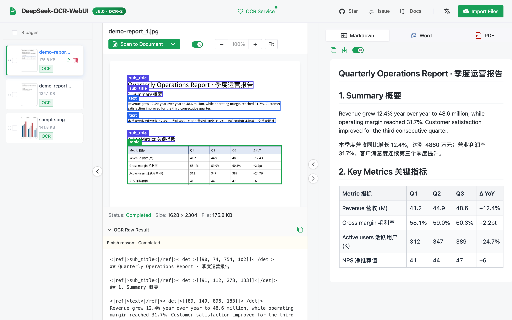
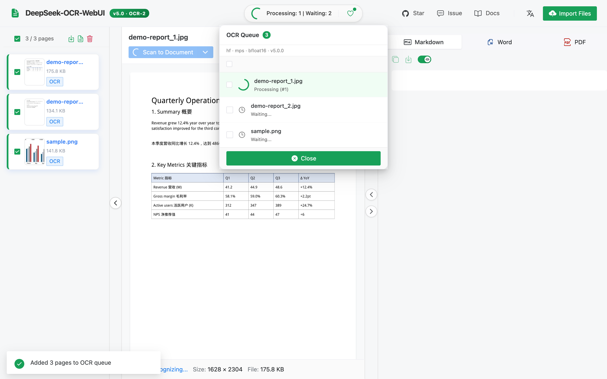
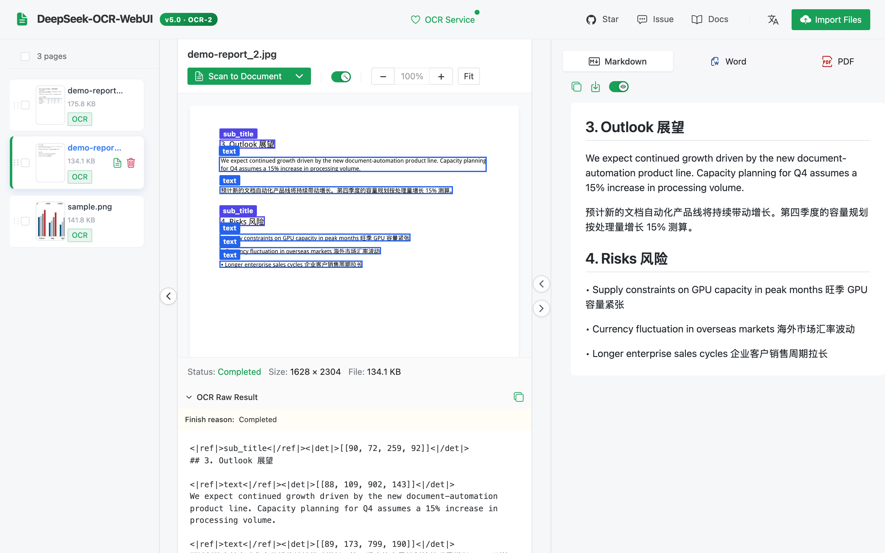
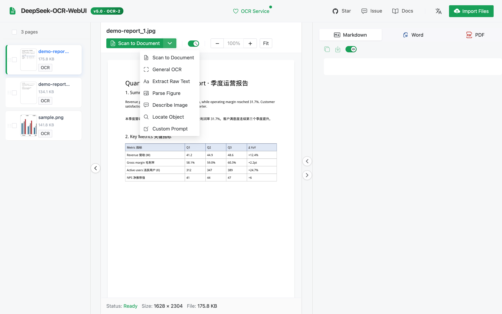
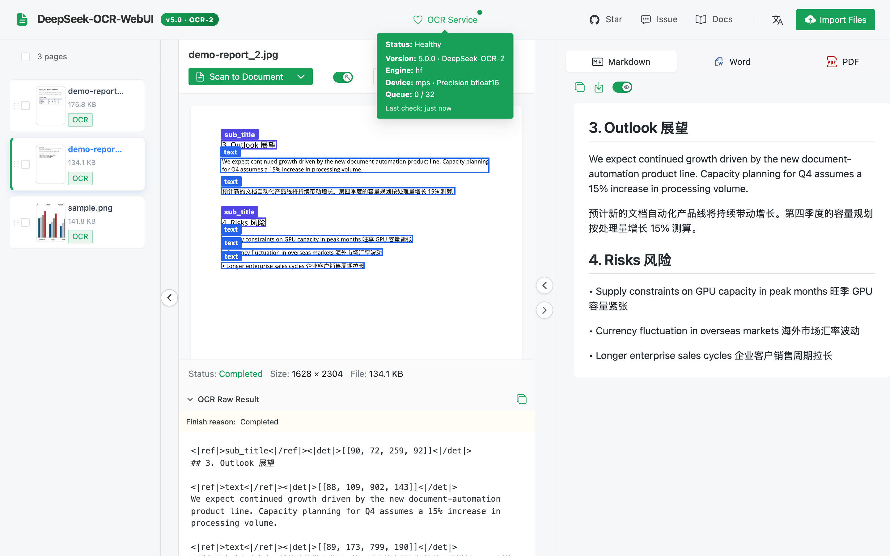
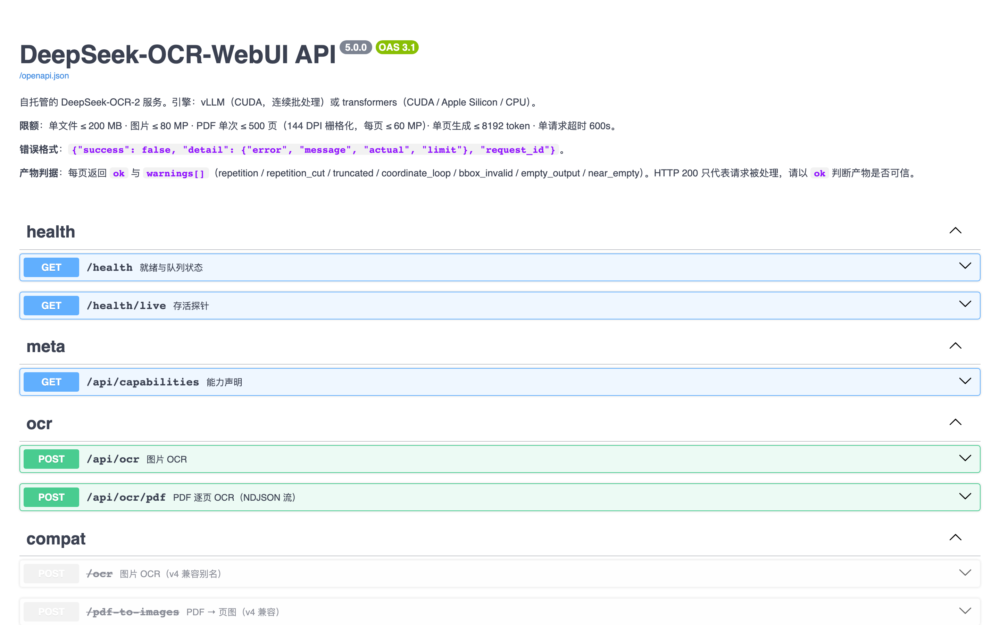
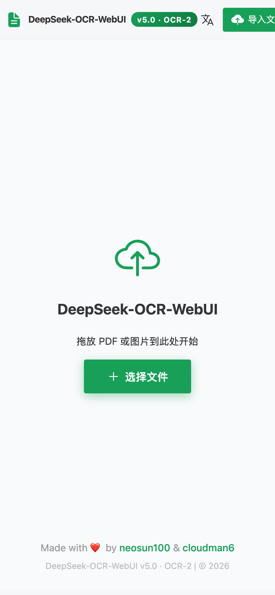

<div align="center">


# DeepSeek-OCR-WebUI

**自托管的 DeepSeek-OCR-2，用于文档与图片 —— NVIDIA 上可选 vLLM 或 transformers，原生支持 Apple Silicon 与 CPU，并逐页做质量检查。**

🌐 [English](README.md) · **简体中文** · [繁體中文](README_zh-TW.md) · [日本語](README_ja.md)

[](CHANGELOG.md)
[](https://huggingface.co/deepseek-ai/DeepSeek-OCR-2)
[](#-快速开始)
[](tests)
[](frontend/src)
[](frontend/tests/e2e/specs)
[](tests/mutations.ini)
[](pyproject.toml)
[](LICENSE)

[新特性](#-v50-新特性) · [截图](#-截图) · [快速开始](#-快速开始) · [API](#-api) · [架构](#-架构) · [性能](#-性能) · [开发](#-开发)

</div>

---

## ✨ v5.0 新特性

v5 从零重构了后端，并加固了 Vue 3 前端。下表每个数字都经过实测；完整列表见 [CHANGELOG](CHANGELOG.md)。

| | v4.1 | **v5.0** |
|---|---|---|
| Apple Silicon / CPU | 能加载，但第一页就失败（上游代码硬编码了 `.cuda()`） | **可用** —— 与设备无关的推理，M5 Max 8.1 页/分钟 |
| NVIDIA 引擎 | 仅 transformers，一次一页 | **vLLM**（连续批处理，A10G 上 132 页/分钟）或 **transformers** |
| 旧 GPU（T4 / V100，无 bf16） | `BFloat16 vs float` 崩溃（#30 #40） | fp16 + eager，已在 T4 上验证 |
| 驱动要求 | CUDA 13 镜像 ⇒ 驱动 ≥ 580（#46） | CUDA 12 构建 |
| Docker 镜像 | 13 GB，权重打包在内（#38） | 权重放在 volume 中；`hf` 镜像解压后 ≈ 4.0 GB |
| 输出质量 | HTTP 200 = "成功" | 逐页 `ok` + `warnings`（重复、截断、坐标循环、空输出） |
| 就绪状态 | 模型还不能读取时 `/health` 就返回 200 | 在一张预热页被正确读回之前返回 503 |
| 大型 PDF | 200 页 ⇒ IndexedDB 中 662 MB，界面卡死（#31 #50） | 78 MB，在 worker 中只解析一次；上传上限 500 MB（#51） |
| Markdown 导出 | 丢失多框块（#49） | 所有样本字符召回率 100 % |
| 安全 | 绑定 `0.0.0.0`，CORS `*` 且携带凭据，`v-html` 导致 XSS | 默认 `127.0.0.1`，CORS 允许列表，DOMPurify |
| 测试 | 后端 0 个测试；123 个前端测试在 Node 26 上失败 | 后端、前端、e2e 与变异测试套件 —— 实时计数见上方徽章 |

---

## 📸 截图

所有截图均由 [`frontend/scripts/screenshots.mjs`](frontend/scripts/screenshots.mjs) 针对真实后端（Apple M5 Max 上的 DeepSeek-OCR-2）生成。演示文档由 [`scripts/make_demo_docs.py`](scripts/make_demo_docs.py) 生成。

<div align="center">

**文档 → 带版面框和渲染表格的 Markdown**



| 批量队列 | PDF 第二页 |
|:---:|:---:|
|  |  |
| **识别模式** | **服务状态（引擎 · 设备 · 精度）** |
|  |  |
| **Swagger UI** | **移动端（简体中文）** |
|  |  |

</div>

---

## 🚀 快速开始

> 🔒 本服务**没有登录**。下面每条命令都只监听 `127.0.0.1`。如需从其他机器访问，请使用 SSH 隧道（`ssh -L 8001:127.0.0.1:8001 you@gpu-host`），或放在会对用户做认证的反向代理之后 —— 不要把端口发布到所有网卡上。

### 方式 1 —— Docker，NVIDIA GPU（vLLM 引擎，推荐）

```bash
git clone https://github.com/neosun100/DeepSeek-OCR-WebUI.git && cd DeepSeek-OCR-WebUI
docker compose up -d                  # 构建镜像；首次启动下载 ~6.8 GB 权重
open http://127.0.0.1:8001            # 界面 ·  API 文档：http://127.0.0.1:8001/docs
```

预构建镜像（每次发版由 CI 发布）：

```bash
docker run -d --gpus all --shm-size 8g -p 127.0.0.1:8001:8001 -v dsocr-models:/models \
  ghcr.io/neosun100/deepseek-ocr-webui:5.0.0          # vLLM 引擎
docker run -d --gpus all --shm-size 8g -p 127.0.0.1:8001:8001 -v dsocr-models:/models \
  ghcr.io/neosun100/deepseek-ocr-webui:5.0.0-hf       # transformers 引擎（更小，也适用于 T4/V100）
```

`/health` 在**模型加载期间返回 503**（首次启动：下载 + 加载 + 预热），一张预热页被正确读回后返回 200。此时 `docker ps` 显示 `healthy`。

### 方式 2 —— macOS（Apple Silicon）或不用 Docker 的 Linux

需要 [uv](https://docs.astral.sh/uv/) 和 Node.js ≥ 20。

```bash
git clone https://github.com/neosun100/DeepSeek-OCR-WebUI.git && cd DeepSeek-OCR-WebUI
(cd frontend && npm ci && npm run build)       # 后端负责提供构建好的界面
uv sync --extra hf                             # transformers + torch（macOS 上用 MPS，Linux 上用 CUDA 12.6 wheels）
uv run deepseek-ocr-webui serve                # http://127.0.0.1:8001
```

在 Linux 上改用 vLLM：`uv sync --extra vllm && uv run deepseek-ocr-webui serve --engine vllm`。

### 离线 / 物理隔离环境

下载一次（`huggingface-cli download deepseek-ai/DeepSeek-OCR-2 --revision aaa02f3811945a91062062994c5c4a3f4c0af2b0 --local-dir /models/ocr2`），然后用 `DSOCR_MODEL_PATH=/models/ocr2` 启动。

### 配置

所有设置都是带 `DSOCR_` 前缀的环境变量（[`config.py`](server/deepseek_ocr_webui/config.py) 是唯一来源）。最常用的几个：

| 变量 | 默认值 | 含义 |
|---|---|---|
| `DSOCR_HOST` / `DSOCR_PORT` | `127.0.0.1` / `8001` | 监听地址。Docker 镜像在容器内设为 `0.0.0.0`；发布的端口才是边界。 |
| `DSOCR_ENGINE` | `auto` | `auto` · `vllm` · `hf`（`auto` = 已安装 vLLM 且 CUDA 可用时用 vLLM） |
| `DSOCR_DEVICE` | `auto` | transformers 引擎：`cuda` · `mps` · `cpu` |
| `DSOCR_REQUIRE_GPU` | `false` | 快速失败，而不是静默回退到 CPU |
| `DSOCR_VLLM_URLS` | — | 逗号分隔的外部 vLLM 服务器（多 GPU / 多主机，按在途请求最少分配） |
| `DSOCR_MODEL_PATH` | — | 本地权重目录（不联网） |
| `DSOCR_MAX_UPLOAD_MB` · `DSOCR_MAX_PDF_PAGES` | `200` · `500` | 上传限制 |
| `DSOCR_MAX_QUEUE` · `DSOCR_MAX_PER_CLIENT` · `DSOCR_MAX_PER_IP` | `32` · `1` · `4` | 准入控制（超出时返回 HTTP 429） |
| `DSOCR_CORS_ORIGINS` | — | 允许列表中的来源（默认关闭） |
| `DSOCR_TRUST_PROXY` | `false` | 信任 `X-Forwarded-For`（仅在你自己的代理之后使用） |

v4 的变量名（`PORT`、`LOCAL_MODEL_PATH`、`FORCE_BACKEND`）仍然有效。

---

## 🧩 识别模式

| 模式 | 提示词 | 输出 |
|---|---|---|
| `document`（默认） | `<|grounding|>Convert the document to markdown.` | 带版面框的 Markdown（表格、标题、图） |
| `ocr` | `<|grounding|>OCR this image.` | 带框的文本行 |
| `free` | `Free OCR.` | 纯文本，最快 |
| `figure` | `Parse the figure.` | 图表 / 插图描述 |
| `describe` | `Describe this image in detail.` | 自然语言描述 |
| `find` | 文档解析 + **服务端块级搜索** | 包含 `find_term` 的版面块（块级，见下文） |
| `freeform` | 你的提示词 | 任意内容 |

> **关于 `find`：** DeepSeek-OCR-2 没有原生的"定位这个短语"提示词 —— 使用 v1 风格的 `Locate <|ref|>…<|/ref|>` 提示词做了 12 次试验，12 次都退化为文档解析。因此 v5 先解析版面，再返回文本中包含你所查词语的那些块的框。精度是按块而不是按词。

---

## 🔌 API

交互式文档：**`/docs`**（Swagger）和 **`/redoc`**。OpenAPI 规范已提交在 [docs/openapi.json](docs/openapi.json)，并由一个测试保持同步。

```bash
# 单张图片
curl -s -F file=@page.png -F prompt_type=document http://127.0.0.1:8001/api/ocr | jq '{ok, warnings, text}'

# 一个 PDF，逐页流式返回（NDJSON：start → page* → done）
curl -sN -F file=@report.pdf -F pages=1-3 http://127.0.0.1:8001/api/ocr/pdf

# 状态 / 能力
curl -s http://127.0.0.1:8001/health | jq '{status, ready, engine, warmup}'
curl -s http://127.0.0.1:8001/api/capabilities | jq '.limits, .known_weak'
```

每个页面结果包含 `text`、`raw_text`（带 `<|ref|>`/`<|det|>` grounding 标签）、`boxes`（像素坐标）、`finish_reason`、**`ok`** 和 **`warnings`**：

| 警告 | 含义 | 是否使 `ok` 失败？ |
|---|---|---|
| `repetition` / `repetition_cut` | 模型在末尾陷入循环；循环部分被裁掉（并在生成过程中被中止） | 是 |
| `truncated` | 达到生成上限 | 是 |
| `coordinate_loop` | 框坐标退化（`[23,268,268,268…]`） | 是 |
| `empty_output` | 什么都没生成 | 是 |
| `near_empty` | ≤ 20 个字母/数字 —— 通常是空白页 | 否 |
| `bbox_invalid` | 部分框超出范围被丢弃；文本保留 | 否 |
| `find_no_match` | `find` 模式：没有块包含该词 | 否 |

错误始终是 `{"success": false, "detail": {"error", "message", "actual", "limit"}, "request_id"}` 的形式。v4 端点 `/ocr`、`/pdf-to-images` 以及 v4 的 `/health` 字段继续可用。

### MCP（Claude、Cursor 等）

```json
{ "mcpServers": { "deepseek-ocr": {
    "command": "uv", "args": ["run", "--directory", "/path/to/DeepSeek-OCR-WebUI", "--extra", "mcp", "deepseek-ocr-webui-mcp"],
    "env": { "DSOCR_BASE": "http://127.0.0.1:8001" } } } }
```

工具：`ocr_image(path | image_base64, mode, find_term, custom_prompt, grounding)`、`ocr_pdf(path, mode, pages)`、`health()`。

---

## 🏗 架构

<picture>
  <source media="(prefers-color-scheme: dark)" srcset="docs/assets/architecture-dark.svg">
  
</picture>

<picture>
  <source media="(prefers-color-scheme: dark)" srcset="docs/assets/ocr-flow-dark.svg">
  
</picture>

- **浏览器** —— PDF 在 Web Worker 中渲染（每个文件只解析一次，字节只传输一次），页面保存在 IndexedDB 中，长任务在刷新后仍能继续；Markdown / DOCX / PDF 在本地生成。
- **服务**（[`server/deepseek_ocr_webui`](server/deepseek_ocr_webui)）—— 准入控制、上传类型嗅探与像素限制、引擎、逐页判定、grounding 解析。
- **引擎** —— `vllm` 从 `vllm serve` 流式读取，一旦检测到重复循环立即关闭流；`hf` 重新实现了上游的预处理，使张量跟随模型真实的设备和 dtype。

---

## 📊 性能

使用 [`scripts/bench.py`](scripts/bench.py) 在专用机器上测得（12 页：示例图片、渲染后的 PDF 页面、已知文本的合成页面；document 模式）。完整记录、显存、一致性与复现步骤：[docs/BENCHMARKS.md](docs/BENCHMARKS.md)。

| 硬件 | 引擎 | 并发 | 页 / 分钟 | p50 延迟 | 已知文本召回率 |
|---|---|---|---|---|---|
| NVIDIA A10G 24 GB | **vLLM 0.33** | 1 | 46.4 | 0.81 s | 1.00 |
| NVIDIA A10G 24 GB | **vLLM 0.33** | 16 | **132.1** | 5.88 s | 1.00 |
| NVIDIA A10G 24 GB | transformers (bf16) | 1 | 9.5 | 2.05 s | 1.00 |
| NVIDIA T4 16 GB | transformers (fp16) | 1 | 7.8 | 2.6 s | 1.00 |
| Apple M5 Max | transformers (MPS, bf16) | 1 | 8.1 | 3.3 s | 1.00 |

vLLM 与 transformers 在相同页面上结果一致，双向字符召回率均值为 0.985（在一张密集页面上最低为 0.849）。transformers 一次只处理一页，因此额外的并发只会排队。

---

## 🛡 限制与已知薄弱点

来自 `GET /api/capabilities`（`known_weak` 列出了公开基准测试证据）：DeepSeek-OCR-2 在**带透视 / 倾斜的照片**、**手写体**和**低资源语言**上较弱。默认值：每次上传 200 MB，每张图片 80 MP，每次请求 500 个 PDF 页面（以 144 DPI 渲染），每页 8192 tokens。

---

## 🧪 开发

```bash
uv sync --extra hf --extra mcp --group dev
uv run pytest -n auto tests/unit tests/regression        # FakeEngine，无需 GPU
DSOCR_REAL_MODEL=1 uv run pytest tests/e2e/test_real_model.py   # 在 CUDA / MPS 上使用真实权重
DSOCR_BASE=http://127.0.0.1:8001 uv run pytest tests/e2e         # 针对正在运行的服务器
cd frontend && npm ci && npx vitest run && npx playwright test --project=chromium
```

- **变异测试** —— [`tests/mutations.ini`](tests/mutations.ini) 列出了刻意植入的 bug（判定、准入、安全默认值、就绪、引擎、MCP）；每个都必须让测试套件变红（用 touchstone `mutate.py` 运行，命令见文件头）。
- **GPU 验证** —— [`scripts/gpu-verify/`](scripts/gpu-verify) 在 GPU 机器上构建两个镜像，分别对其运行 e2e 套件、做基准测试并比对输出。
- **生成的资源** —— `node frontend/scripts/screenshots.mjs`、`uv run python scripts/badges.py [--check]`、`deepseek-ocr-webui openapi > docs/openapi.json`。
- CI：GitHub Actions（后端 · 前端 · e2e · 镜像构建）和 GitLab CI。

### 从 v4 升级

- 端口不变（8001），界面不变，`/ocr` 和 `/health` 保持兼容。Docker 镜像不再包含权重：请在 `/models` 挂载一个 volume。
- 容器内监听 `0.0.0.0`，compose 只发布到 `127.0.0.1` —— 如需局域网访问，请有意识地修改发布配置，并在前面加上认证。
- `find` 现在需要 `find_term`，返回块级匹配。

---

## 👥 贡献者

<table>
<tr>
<td align="center">
<a href="https://github.com/cloudman6"><br/><sub><b>CloudMan</b></sub></a><br/>
<sub>🏆 Vue 3 前端负责人（PR #34, #41）</sub>
</td>
<td align="center">
<a href="https://github.com/neosun100"><br/><sub><b>neosun100</b></sub></a><br/>
<sub>🎯 维护者 · 后端 · Docker</sub>
</td>
</tr>
</table>

Vue 3 前端（包括其 E2E 测试套件）由 [@cloudman6](https://github.com/cloudman6) 贡献，是 v5 的基础。

## 📈 Star 历史

[](https://star-history.com/#neosun100/DeepSeek-OCR-WebUI&Date)

## 🤝 参与贡献

欢迎提交 Issue 和 Pull Request。提交 PR 前请先运行后端和前端测试套件；CI 会在每个 Pull Request 上运行它们。

## 📄 许可证

[MIT](LICENSE)。DeepSeek-OCR-2 权重由 DeepSeek 按其自有许可证分发。

## 🙏 致谢

[DeepSeek-AI](https://github.com/deepseek-ai) 提供 DeepSeek-OCR-2 · [vLLM](https://github.com/vllm-project/vllm) 提供原生 OCR-2 支持和 NGram logits processor · [@cloudman6](https://github.com/cloudman6) 以及所有报告问题的人。
