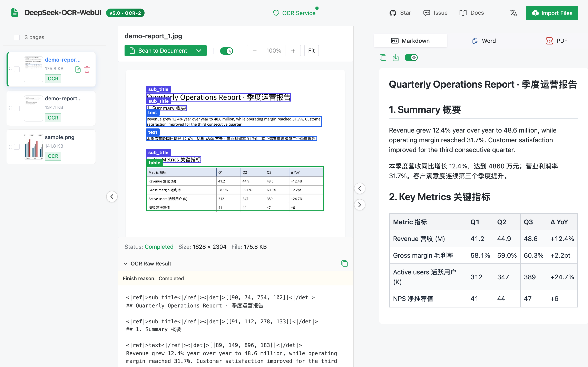
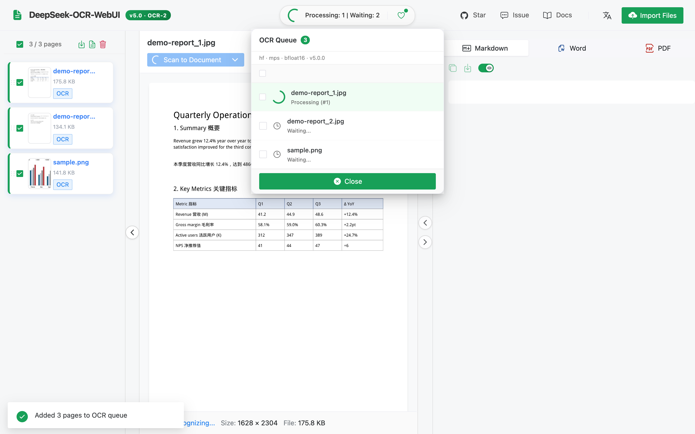
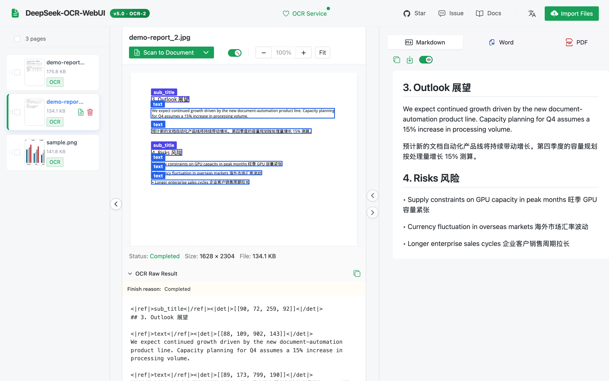
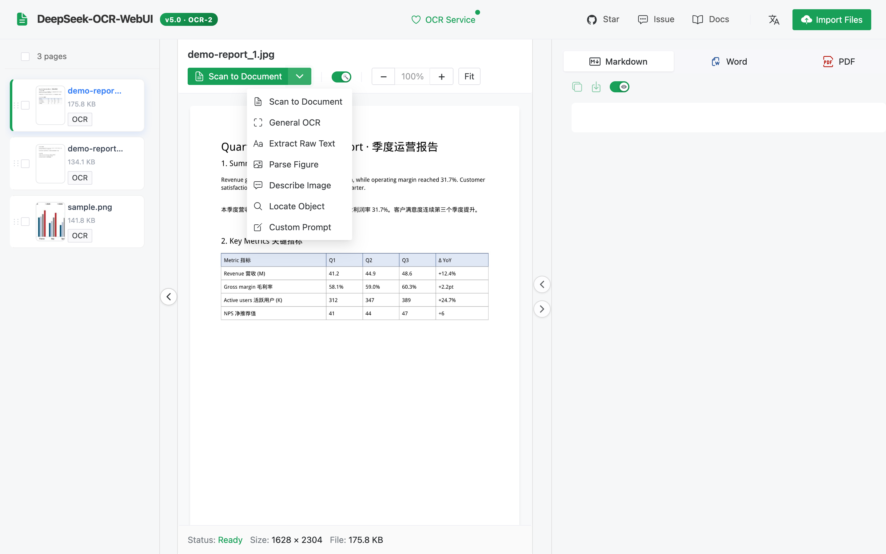
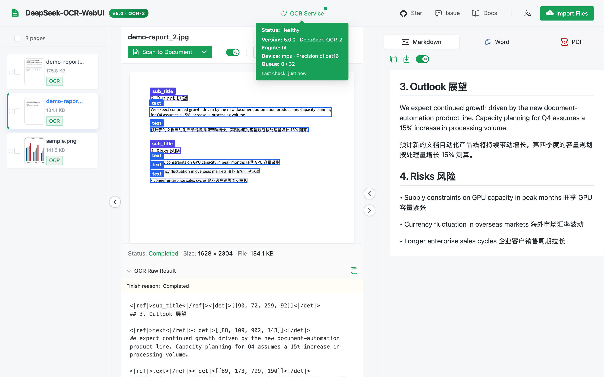
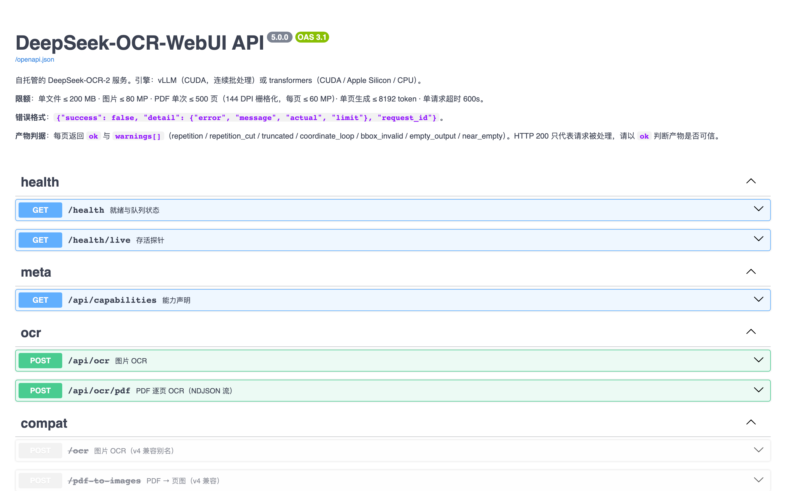
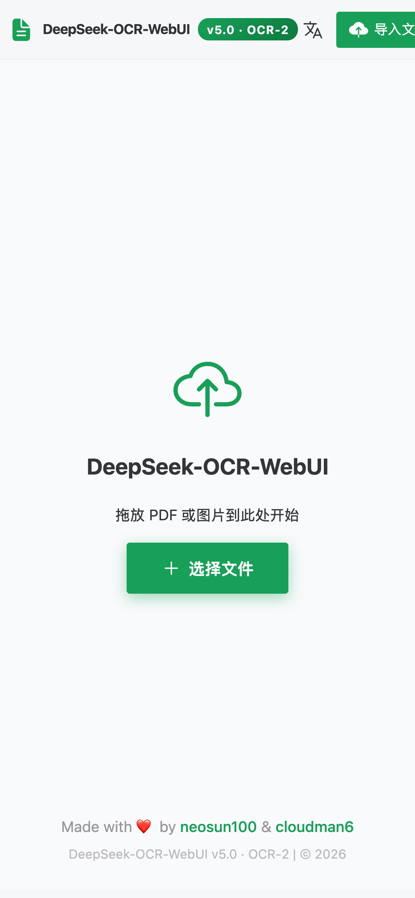

<div align="center">


# DeepSeek-OCR-WebUI

**自行架設的 DeepSeek-OCR-2，適用於文件與影像 —— NVIDIA 上可選 vLLM 或 transformers，原生支援 Apple Silicon 與 CPU，並逐頁進行品質檢查。**

🌐 [English](README.md) · [简体中文](README_zh-CN.md) · **繁體中文** · [日本語](README_ja.md)

[](CHANGELOG.md)
[](https://huggingface.co/deepseek-ai/DeepSeek-OCR-2)
[](#-快速開始)
[](tests)
[](frontend/src)
[](frontend/tests/e2e/specs)
[](tests/mutations.ini)
[](pyproject.toml)
[](LICENSE)

[新功能](#-v50-新功能) · [螢幕截圖](#-螢幕截圖) · [快速開始](#-快速開始) · [API](#-api) · [架構](#-架構) · [效能](#-效能) · [開發](#-開發)

</div>

---

## ✨ v5.0 新功能

v5 從頭翻修了後端，並強化了 Vue 3 前端。下表每個數字都經過實測；完整清單請見 [CHANGELOG](CHANGELOG.md)。

| | v4.1 | **v5.0** |
|---|---|---|
| Apple Silicon / CPU | 能載入，但第一頁就失敗（上游程式碼寫死了 `.cuda()`） | **可用** —— 與裝置無關的推論，M5 Max 8.1 頁/分鐘 |
| NVIDIA 引擎 | 僅 transformers，一次一頁 | **vLLM**（連續批次處理，A10G 上 132 頁/分鐘）或 **transformers** |
| 舊 GPU（T4 / V100，無 bf16） | `BFloat16 vs float` 當機（#30 #40） | fp16 + eager，已在 T4 上驗證 |
| 驅動程式需求 | CUDA 13 映像檔 ⇒ 驅動程式 ≥ 580（#46） | CUDA 12 建置 |
| Docker 映像檔 | 13 GB，權重打包在內（#38） | 權重放在 volume 中；`hf` 映像檔解壓後 ≈ 4.0 GB |
| 輸出品質 | HTTP 200 = 「成功」 | 逐頁 `ok` + `warnings`（重複、截斷、座標迴圈、空白輸出） |
| 就緒狀態 | 模型還無法讀取時 `/health` 就回傳 200 | 在一張預熱頁被正確讀回之前回傳 503 |
| 大型 PDF | 200 頁 ⇒ IndexedDB 中 662 MB，畫面凍結（#31 #50） | 78 MB，在 worker 中只解析一次；上傳上限 500 MB（#51） |
| Markdown 匯出 | 遺失多框區塊（#49） | 所有樣本字元召回率 100 % |
| 安全性 | 綁定 `0.0.0.0`，CORS `*` 且攜帶憑證，`v-html` 導致 XSS | 預設 `127.0.0.1`，CORS 允許清單，DOMPurify |
| 測試 | 後端 0 個測試；123 個前端測試在 Node 26 上失敗 | 後端、前端、e2e 與變異測試套件 —— 即時計數請見上方徽章 |

---

## 📸 螢幕截圖

所有螢幕截圖皆由 [`frontend/scripts/screenshots.mjs`](frontend/scripts/screenshots.mjs) 針對真實後端（Apple M5 Max 上的 DeepSeek-OCR-2）產生。示範文件由 [`scripts/make_demo_docs.py`](scripts/make_demo_docs.py) 產生。

<div align="center">

**文件 → 含版面框與已渲染表格的 Markdown**



| 批次佇列 | PDF 第二頁 |
|:---:|:---:|
|  |  |
| **辨識模式** | **服務狀態（引擎 · 裝置 · 精度）** |
|  |  |
| **Swagger UI** | **行動版（简体中文）** |
|  |  |

</div>

---

## 🚀 快速開始

> 🔒 本服務**沒有登入機制**。下面每個指令都只監聽 `127.0.0.1`。若要從其他機器使用，請使用 SSH 通道（`ssh -L 8001:127.0.0.1:8001 you@gpu-host`），或放在會驗證使用者身分的反向代理之後 —— 不要把連接埠發布到所有網路介面上。

### 選項 1 —— Docker，NVIDIA GPU（vLLM 引擎，建議）

```bash
git clone https://github.com/neosun100/DeepSeek-OCR-WebUI.git && cd DeepSeek-OCR-WebUI
docker compose up -d                  # 建置映像檔；首次啟動下載 ~6.8 GB 權重
open http://127.0.0.1:8001            # 介面 ·  API 文件：http://127.0.0.1:8001/docs
```

預先建置的映像檔（每次發行時由 CI 發布）：

```bash
docker run -d --gpus all --shm-size 8g -p 127.0.0.1:8001:8001 -v dsocr-models:/models \
  ghcr.io/neosun100/deepseek-ocr-webui:5.0.0          # vLLM 引擎
docker run -d --gpus all --shm-size 8g -p 127.0.0.1:8001:8001 -v dsocr-models:/models \
  ghcr.io/neosun100/deepseek-ocr-webui:5.0.0-hf       # transformers 引擎（較小，也適用於 T4/V100）
```

`/health` 在**模型載入期間回傳 503**（首次啟動：下載 + 載入 + 預熱），一張預熱頁被正確讀回後回傳 200。此時 `docker ps` 會顯示 `healthy`。

### 選項 2 —— macOS（Apple Silicon）或不使用 Docker 的 Linux

需要 [uv](https://docs.astral.sh/uv/) 與 Node.js ≥ 20。

```bash
git clone https://github.com/neosun100/DeepSeek-OCR-WebUI.git && cd DeepSeek-OCR-WebUI
(cd frontend && npm ci && npm run build)       # 由後端提供建置好的介面
uv sync --extra hf                             # transformers + torch（macOS 上用 MPS，Linux 上用 CUDA 12.6 wheels）
uv run deepseek-ocr-webui serve                # http://127.0.0.1:8001
```

在 Linux 上改用 vLLM：`uv sync --extra vllm && uv run deepseek-ocr-webui serve --engine vllm`。

### 離線 / 實體隔離環境

下載一次（`huggingface-cli download deepseek-ai/DeepSeek-OCR-2 --revision aaa02f3811945a91062062994c5c4a3f4c0af2b0 --local-dir /models/ocr2`），然後以 `DSOCR_MODEL_PATH=/models/ocr2` 啟動。

### 設定

所有設定都是帶 `DSOCR_` 前綴的環境變數（[`config.py`](server/deepseek_ocr_webui/config.py) 是唯一來源）。最實用的幾個：

| 變數 | 預設值 | 意義 |
|---|---|---|
| `DSOCR_HOST` / `DSOCR_PORT` | `127.0.0.1` / `8001` | 監聽位址。Docker 映像檔在容器內設為 `0.0.0.0`；發布的連接埠才是邊界。 |
| `DSOCR_ENGINE` | `auto` | `auto` · `vllm` · `hf`（`auto` = 已安裝 vLLM 且 CUDA 可用時使用 vLLM） |
| `DSOCR_DEVICE` | `auto` | transformers 引擎：`cuda` · `mps` · `cpu` |
| `DSOCR_REQUIRE_GPU` | `false` | 立即失敗，而不是默默退回 CPU |
| `DSOCR_VLLM_URLS` | — | 以逗號分隔的外部 vLLM 伺服器（多 GPU / 多主機，依進行中請求最少者分配） |
| `DSOCR_MODEL_PATH` | — | 本機權重目錄（不連網） |
| `DSOCR_MAX_UPLOAD_MB` · `DSOCR_MAX_PDF_PAGES` | `200` · `500` | 上傳限制 |
| `DSOCR_MAX_QUEUE` · `DSOCR_MAX_PER_CLIENT` · `DSOCR_MAX_PER_IP` | `32` · `1` · `4` | 准入控制（超出時回傳 HTTP 429） |
| `DSOCR_CORS_ORIGINS` | — | 允許清單中的來源（預設關閉） |
| `DSOCR_TRUST_PROXY` | `false` | 信任 `X-Forwarded-For`（僅在你自己的代理之後使用） |

v4 的變數名稱（`PORT`、`LOCAL_MODEL_PATH`、`FORCE_BACKEND`）仍然有效。

---

## 🧩 辨識模式

| 模式 | 提示詞 | 輸出 |
|---|---|---|
| `document`（預設） | `<|grounding|>Convert the document to markdown.` | 含版面框的 Markdown（表格、標題、圖） |
| `ocr` | `<|grounding|>OCR this image.` | 含框的文字行 |
| `free` | `Free OCR.` | 純文字，最快 |
| `figure` | `Parse the figure.` | 圖表 / 插圖描述 |
| `describe` | `Describe this image in detail.` | 自然語言描述 |
| `find` | 文件解析 + **伺服器端區塊搜尋** | 包含 `find_term` 的版面區塊（區塊層級，見下文） |
| `freeform` | 你的提示詞 | 任何內容 |

> **關於 `find`：** DeepSeek-OCR-2 沒有原生的「定位這個詞組」提示詞 —— 以 v1 風格的 `Locate <|ref|>…<|/ref|>` 提示詞進行 12 次試驗，12 次都退回成文件解析。因此 v5 先解析版面，再回傳文字中包含你所查詞語的那些區塊的框。精度以區塊為單位，而非以字詞為單位。

---

## 🔌 API

互動式文件：**`/docs`**（Swagger）與 **`/redoc`**。OpenAPI 規格已提交於 [docs/openapi.json](docs/openapi.json)，並由一個測試保持同步。

```bash
# 單張影像
curl -s -F file=@page.png -F prompt_type=document http://127.0.0.1:8001/api/ocr | jq '{ok, warnings, text}'

# 一個 PDF，逐頁串流回傳（NDJSON：start → page* → done）
curl -sN -F file=@report.pdf -F pages=1-3 http://127.0.0.1:8001/api/ocr/pdf

# 狀態 / 能力
curl -s http://127.0.0.1:8001/health | jq '{status, ready, engine, warmup}'
curl -s http://127.0.0.1:8001/api/capabilities | jq '.limits, .known_weak'
```

每個頁面結果包含 `text`、`raw_text`（含 `<|ref|>`/`<|det|>` grounding 標籤）、`boxes`（像素座標）、`finish_reason`、**`ok`** 與 **`warnings`**：

| 警告 | 意義 | 是否使 `ok` 失敗？ |
|---|---|---|
| `repetition` / `repetition_cut` | 模型在結尾陷入迴圈；迴圈部分被裁掉（並在生成過程中被中止） | 是 |
| `truncated` | 達到生成上限 | 是 |
| `coordinate_loop` | 框座標退化（`[23,268,268,268…]`） | 是 |
| `empty_output` | 什麼都沒有生成 | 是 |
| `near_empty` | ≤ 20 個字母/數字 —— 通常是空白頁 | 否 |
| `bbox_invalid` | 部分框超出範圍而被捨棄；文字保留 | 否 |
| `find_no_match` | `find` 模式：沒有區塊包含該詞 | 否 |

錯誤一律是 `{"success": false, "detail": {"error", "message", "actual", "limit"}, "request_id"}` 的形式。v4 端點 `/ocr`、`/pdf-to-images` 以及 v4 的 `/health` 欄位持續可用。

### MCP（Claude、Cursor 等）

```json
{ "mcpServers": { "deepseek-ocr": {
    "command": "uv", "args": ["run", "--directory", "/path/to/DeepSeek-OCR-WebUI", "--extra", "mcp", "deepseek-ocr-webui-mcp"],
    "env": { "DSOCR_BASE": "http://127.0.0.1:8001" } } } }
```

工具：`ocr_image(path | image_base64, mode, find_term, custom_prompt, grounding)`、`ocr_pdf(path, mode, pages)`、`health()`。

---

## 🏗 架構

<picture>
  <source media="(prefers-color-scheme: dark)" srcset="docs/assets/architecture-dark.svg">
  
</picture>

<picture>
  <source media="(prefers-color-scheme: dark)" srcset="docs/assets/ocr-flow-dark.svg">
  
</picture>

- **瀏覽器** —— PDF 在 Web Worker 中渲染（每個檔案只解析一次，位元組只傳輸一次），頁面保存在 IndexedDB 中，長時間的工作在重新整理後仍能延續；Markdown / DOCX / PDF 在本機產生。
- **服務**（[`server/deepseek_ocr_webui`](server/deepseek_ocr_webui)）—— 准入控制、上傳類型偵測與像素限制、引擎、逐頁判定、grounding 解析。
- **引擎** —— `vllm` 從 `vllm serve` 串流讀取，一旦偵測到重複迴圈便立即關閉串流；`hf` 重新實作了上游的前處理，使張量跟隨模型實際的裝置與 dtype。

---

## 📊 效能

使用 [`scripts/bench.py`](scripts/bench.py) 在專用機器上測得（12 頁：範例影像、渲染後的 PDF 頁面、已知文字的合成頁面；document 模式）。完整紀錄、記憶體、一致性與重現步驟：[docs/BENCHMARKS.md](docs/BENCHMARKS.md)。

| 硬體 | 引擎 | 並行數 | 頁 / 分鐘 | p50 延遲 | 已知文字召回率 |
|---|---|---|---|---|---|
| NVIDIA A10G 24 GB | **vLLM 0.33** | 1 | 46.4 | 0.81 s | 1.00 |
| NVIDIA A10G 24 GB | **vLLM 0.33** | 16 | **132.1** | 5.88 s | 1.00 |
| NVIDIA A10G 24 GB | transformers (bf16) | 1 | 9.5 | 2.05 s | 1.00 |
| NVIDIA T4 16 GB | transformers (fp16) | 1 | 7.8 | 2.6 s | 1.00 |
| Apple M5 Max | transformers (MPS, bf16) | 1 | 8.1 | 3.3 s | 1.00 |

vLLM 與 transformers 在相同頁面上的結果一致，雙向字元召回率平均為 0.985（在一張內容密集的頁面上最低為 0.849）。transformers 一次只處理一頁，因此額外的並行只會排隊。

---

## 🛡 限制與已知弱點

來自 `GET /api/capabilities`（`known_weak` 列出了公開基準測試的證據）：DeepSeek-OCR-2 在**帶有透視 / 傾斜的照片**、**手寫字**與**低資源語言**上表現較弱。預設值：每次上傳 200 MB，每張影像 80 MP，每次請求 500 個 PDF 頁面（以 144 DPI 渲染），每頁 8192 tokens。

---

## 🧪 開發

```bash
uv sync --extra hf --extra mcp --group dev
uv run pytest -n auto tests/unit tests/regression        # FakeEngine，不需要 GPU
DSOCR_REAL_MODEL=1 uv run pytest tests/e2e/test_real_model.py   # 在 CUDA / MPS 上使用真實權重
DSOCR_BASE=http://127.0.0.1:8001 uv run pytest tests/e2e         # 針對執行中的伺服器
cd frontend && npm ci && npx vitest run && npx playwright test --project=chromium
```

- **變異測試** —— [`tests/mutations.ini`](tests/mutations.ini) 列出了刻意植入的 bug（判定、准入、安全預設值、就緒、引擎、MCP）；每一個都必須讓測試套件變紅（以 touchstone `mutate.py` 執行，指令見檔案開頭）。
- **GPU 驗證** —— [`scripts/gpu-verify/`](scripts/gpu-verify) 在 GPU 機器上建置兩個映像檔，分別對其執行 e2e 套件、進行基準測試並比對輸出。
- **產生的資產** —— `node frontend/scripts/screenshots.mjs`、`uv run python scripts/badges.py [--check]`、`deepseek-ocr-webui openapi > docs/openapi.json`。
- CI：GitHub Actions（後端 · 前端 · e2e · 映像檔建置）與 GitLab CI。

### 從 v4 升級

- 連接埠相同（8001），介面相同，`/ocr` 與 `/health` 保持相容。Docker 映像檔不再包含權重：請在 `/models` 掛載一個 volume。
- 容器內監聽 `0.0.0.0`，compose 只發布到 `127.0.0.1` —— 若需要區域網路存取，請刻意修改發布設定，並在前方加上身分驗證。
- `find` 現在需要 `find_term`，並回傳區塊層級的符合結果。

---

## 👥 貢獻者

<table>
<tr>
<td align="center">
<a href="https://github.com/cloudman6"><br/><sub><b>CloudMan</b></sub></a><br/>
<sub>🏆 Vue 3 前端負責人（PR #34, #41）</sub>
</td>
<td align="center">
<a href="https://github.com/neosun100"><br/><sub><b>neosun100</b></sub></a><br/>
<sub>🎯 維護者 · 後端 · Docker</sub>
</td>
</tr>
</table>

Vue 3 前端（包含其 E2E 測試套件）由 [@cloudman6](https://github.com/cloudman6) 貢獻，是 v5 的基礎。

## 📈 Star 歷史

[](https://star-history.com/#neosun100/DeepSeek-OCR-WebUI&Date)

## 🤝 參與貢獻

歡迎提交 Issue 與 Pull Request。開 PR 前請先執行後端與前端測試套件；CI 會在每個 Pull Request 上執行它們。

## 📄 授權

[MIT](LICENSE)。DeepSeek-OCR-2 權重由 DeepSeek 依其自有授權條款散布。

## 🙏 致謝

[DeepSeek-AI](https://github.com/deepseek-ai) 提供 DeepSeek-OCR-2 · [vLLM](https://github.com/vllm-project/vllm) 提供原生 OCR-2 支援與 NGram logits processor · [@cloudman6](https://github.com/cloudman6) 以及所有回報問題的人。
